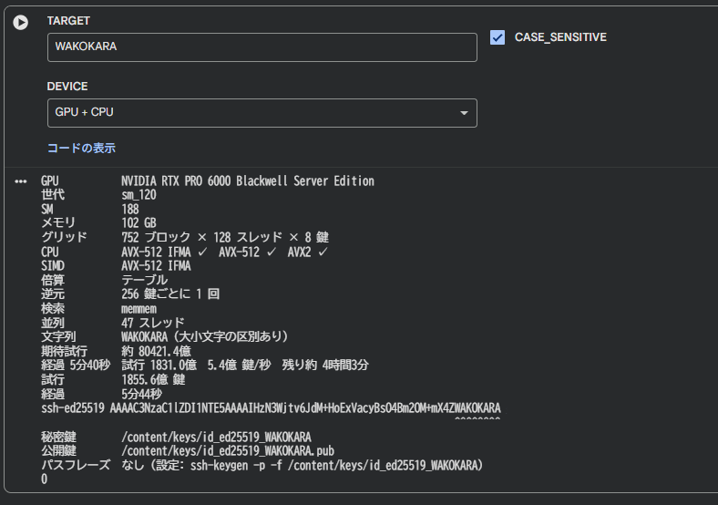

# meikey — SSH vanity key generator

[English](README.md) | 日本語

[](https://colab.research.google.com/github/waxsd100/meikey/blob/master/colab/meikey.ipynb)
[](https://github.com/waxsd100/meikey/actions/workflows/ci.yml)
[](https://github.com/waxsd100/meikey/actions/workflows/ci.yml)
[](docs/benchmark.ja.md)
[](#ライセンス)
[](https://www.rust-lang.org)
[](#gpu)
[](https://github.com/waxsd100/meikey/commits/master)
[](https://gijutsusharin.li)

**公開鍵に好きな文字列が入った SSH 鍵（ed25519）を作るツール。** `ssh-keygen -t ed25519` と同じ OpenSSH 形式の鍵を、CPU と NVIDIA の GPU で総当たりして探す。名前は 銘（めい）＋ key。

**毎秒約 10 億鍵**を探せる（RTX PRO 6000 と AMD EPYC 9B45 の GPU + CPU で 9.6億 鍵/秒。[ツールの比較](docs/comparison.ja.md)）。

Google Colab（RTX PRO 6000、GPU + CPU）で `WAKOKARA` を大小文字を区別して探し、見つけたときの出力:

```
$ meikey WAKOKARA -s --low-security --both -o /content/keys/id_ed25519_WAKOKARA
GPU           NVIDIA RTX PRO 6000 Blackwell Server Edition
世代          sm_120
SM            188
メモリ        102 GB
グリッド      752 ブロック × 128 スレッド × 8 鍵
CPU           AVX-512 IFMA ✓  AVX-512 ✓  AVX2 ✓
SIMD          AVX-512 IFMA
倍算          テーブル
逆元          256 鍵ごとに 1 回
検索          memmem
並列          47 スレッド
文字列        WAKOKARA（大小文字の区別あり）
期待試行      約 80421.4億
経過 5分40秒  試行 1831.0億  5.4億 鍵/秒  残り約 4時間3分
試行          1855.6億 鍵
経過          5分44秒
ssh-ed25519 AAAAC3NzaC1lZDI1NTE5AAAAIHzN3Wjtv6JdM+HoExVacyBsO4Bm2OM+mX4ZWAKOKARA
                                                                        ^^^^^^^^
秘密鍵        /content/keys/id_ed25519_WAKOKARA
公開鍵        /content/keys/id_ed25519_WAKOKARA.pub
パスフレーズ  なし（設定: ssh-keygen -p -f /content/keys/id_ed25519_WAKOKARA）
```



- 作った鍵（`id_ed25519_…` と `.pub`）は、そのまま `~/.ssh/` や `authorized_keys` に使える
- 文字列は、どこかに含む・最後（`--suffix`）・正規表現（`--regex`）で指定できる
- CPU は AVX2・AVX-512・AVX-512 IFMA、GPU は CUDA（Turing 以降）で計算する

## インストール

- Rust 1.99 以上（`rustup toolchain install` で入る）
- [cargo-make](https://github.com/sagiegurari/cargo-make)（`cargo install cargo-make`）
- GPU を使うなら NVIDIA のドライバ R525 以降（CUDA Toolkit は要らない）

```sh
git clone https://github.com/waxsd100/meikey && cd meikey
cargo make build        # target/release/meikey ができる
```

下の例の `meikey` は `target/release/meikey` のこと。`cargo make run …` でも、ビルドしてそのまま同じ引数で実行できる。

## 使い方

```sh
meikey wakokara -o ~/.ssh/id_ed25519_wakokara      # 公開鍵に wakokara が入った鍵を探して書き出す
meikey wakokara --bench 10                         # 探さずに速さと期待時間を測る
meikey wakokara --suffix                           # 公開鍵の最後が wakokara の鍵
meikey 'wako(kara)?$' --regex                      # 正規表現で探す
meikey wakokara --low-security --both              # GPU と CPU の両方で探す（下の「安全性」を参照）
```

引数を付けずに起動すると、必要なことを順に聞いてから始める。

秘密鍵にはパスフレーズが付いていないので、使う前に付ける。

```sh
ssh-keygen -p -f ~/.ssh/id_ed25519_wakokara
```

### 入れられる文字列

- 使える文字は `A-Z a-z 0-9 + /`（base64 の文字）で、最大 42 文字
- 入るのは固定部分 `ssh-ed25519 AAAAC3NzaC1lZDI1NTE5AAAAI` の後ろ
- 大文字小文字は区別しない（`-s` で区別する）。区別しないと `WaKoKaRa` のように混ざった形で出る

`--regex` では、固定部分の後ろの 43 文字に正規表現を当てる。

- `^` は固定部分の直後、`$` は最後
- 固定部分の直後の 1 文字は `A`〜`P` のどれかなので、`^Q` のように一致する鍵が無いものはエラーになる
- 空の文字列に一致するもの（`a*` など）は、どの鍵にも一致するので使えない
- GPU でも使える

### オプション

| オプション | 意味 |
|---|---|
| `-s` | 大文字小文字を区別する |
| `--suffix` | 公開鍵の最後が文字列で終わる鍵だけを探す |
| `--regex` | 文字列を正規表現として探す |
| `-o PATH` | 秘密鍵の出力先（既定: `id_ed25519_meikey`）。公開鍵は `PATH.pub` |
| `-C TEXT` | 鍵のコメント |
| `-f` | 既存のファイルを置き換える |
| `-j N` | スレッド数（既定: 全コア） |
| `--bench SECS` | 探さずに速さだけ測る |
| `--check` | 使う CPU・GPU と計算方法を表示して終わる |
| `--low-security` | 低セキュリティモード（速さを優先する） |
| `--gpu` / `--both` | GPU だけ / GPU と CPU の両方で探す（`--low-security` のとき）。GPU が複数あれば全部使う |
| `--gpu-width`・`--gpu-batch`・`--gpu-limbs` | GPU の設定（付けなければ、探す前に GPU で測って一番速いものを使う） |
| `--simd LEVEL` | 使う SIMD の上限（`avx512-ifma`・`avx512`・`avx2`・`off`） |

全部のオプションは `meikey --help` で見られる。表示は、ロケール（環境変数 LANG・LC_ALL など。無ければ OS の設定）が日本語なら日本語、それ以外は英語になる。

### GPU

Turing（RTX 20 シリーズ・T4）以降の NVIDIA の GPU で動く。GPU の計算は定数時間ではないので、`--gpu`・`--both` は `--low-security` と一緒に付ける。

## かかる時間

英字 `N` 文字が確率 `P` で見つかるまでに試す鍵の数:

$$ C = \frac{b^{N} \ln \bigl(\frac{1}{1-P}\bigr)}{43 - N} $$

`b` は大小文字を区別しないなら 32、区別する（`-s`）なら 64。`43 − N` は文字列が入る位置の数（`--suffix` なら 1）。`--bench` でその文字列の期待時間を表示する。

大小文字を区別しない:

| N \ P | 50% | 90% | 99% | 99.9% |
|---|---|---|---|---|
| 2 | 17 | 58 | 115 | 173 |
| 3 | 568 | 1886 | 3773 | 5659 |
| 4 | 1.9万 | 6.2万 | 12.4万 | 18.6万 |
| 5 | 61.2万 | 203.3万 | 406.6万 | 610.0万 |
| 6 | 2011.5万 | 6682.1万 | 1.3億 | 2.0億 |
| 7 | 6.6億 | 22.0億 | 44.0億 | 65.9億 |
| 8 | 217.7億 | 723.3億 | 1446.7億 | 2170.0億 |
| 9 | 7172.9億 | 2.4兆 | 4.8兆 | 7.1兆 |
| 10 | 23.6兆 | 78.6兆 | 157.1兆 | 235.7兆 |
| 11 | 780.4兆 | 2592.5兆 | 5185.0兆 | 7777.4兆 |
| 12 | 2.6京 | 8.6京 | 17.1京 | 25.7京 |

大小文字を区別する（`-s`）:

| N \ P | 50% | 90% | 99% | 99.9% |
|---|---|---|---|---|
| 2 | 69 | 230 | 460 | 690 |
| 3 | 4543 | 1.5万 | 3.0万 | 4.5万 |
| 4 | 29.8万 | 99.1万 | 198.1万 | 297.2万 |
| 5 | 1958.6万 | 6506.3万 | 1.3億 | 2.0億 |
| 6 | 12.9億 | 42.8億 | 85.5億 | 128.3億 |
| 7 | 846.8億 | 2813.0億 | 5626.0億 | 8439.1億 |
| 8 | 5.6兆 | 18.5兆 | 37.0兆 | 55.6兆 |
| 9 | 367.3兆 | 1220.0兆 | 2440.0兆 | 3660.0兆 |
| 10 | 2.4京 | 8.0京 | 16.1京 | 24.1京 |
| 11 | 159.8京 | 530.9京 | 1061.9京 | 1592.8京 |
| 12 | 10559.0京 | 35076.3京 | 70152.6京 | 105228.9京 |

平均でかかる時間（RTX PRO 6000・AMD EPYC 9B45 のマシンで[測った速さ](docs/comparison.ja.md#結果)。CPU は既定のモード、GPU + CPU は低セキュリティモード）:

| 文字数 | 区別なし: 期待試行 | CPU（5130万 鍵/秒） | GPU + CPU（9.6億 鍵/秒） | 区別あり: 期待試行 | CPU | GPU + CPU |
|---|---|---|---|---|---|---|
| 4 | 2.7万 | 1 秒未満 | 1 秒未満 | 43.0万 | 1 秒未満 | 1 秒未満 |
| 5 | 88.3万 | 1 秒未満 | 1 秒未満 | 2825.6万 | 1 秒未満 | 1 秒未満 |
| 6 | 2902.0万 | 1 秒未満 | 1 秒未満 | 18.6億 | 36 秒 | 2 秒 |
| 7 | 9.5億 | 19 秒 | 1 秒未満 | 1221.7億 | 40 分 | 2 分 |
| 8 | 314.1億 | 10 分 | 33 秒 | 8.0兆 | 2 日 | 2.3 時間 |
| 9 | 1.0兆 | 5.6 時間 | 18 分 | 529.8兆 | 120 日 | 6 日 |
| 10 | 34.1兆 | 8 日 | 9.9 時間 | 3.5京 | 22 年 | 1 年 |
| 11 | 1125.9兆 | 254 日 | 14 日 | 230.6京 | 1,425 年 | 77 年 |
| 12 | 3.7京 | 23 年 | 1 年 | 15233.4京 | 94,162 年 | 5,056 年 |

ほかの環境の速さは [ベンチマーク](docs/benchmark.ja.md)、ほかのツールとの比較は [ツールの比較](docs/comparison.ja.md) にある。

## Google Colab

上の **Open in Colab** から開き、セルを上から順に実行する。ランタイムのタイプで GPU を選び、フォームで GPU・CPU・GPU + CPU のどれを使うか選べる。

秘密鍵は Colab の VM 上で作られる。ダウンロードしたら VM から消し、手元でパスフレーズを付ける。

ほかのツールと同じマシンで速さを比べるノートブックは [colab/compare.ipynb](https://colab.research.google.com/github/waxsd100/meikey/blob/master/colab/compare.ipynb)。

## 安全性

| | 既定のモード | 低セキュリティモード（`--low-security`） |
|---|---|---|
| 倍算 | 定数時間（計算の時間と読むメモリの場所が秘密鍵によらない） | 定数時間でない表の倍算。同じ CPU を使うほかのプロセスや VM から、キャッシュのタイミングで秘密鍵を推測される余地がある |
| シード | 鍵ごとに ChaCha20 で作る | OS の乱数（CPU はスレッドごと、GPU は探索を始めるときに 1 回）に通し番号を足したもの。同じ乱数から作った鍵のシードが 1 本でも漏れると、ほかの鍵のシードも求まる |
| GPU | 使えない | 使える（GPU の計算も定数時間でない） |

どちらのモードでも、マシンの管理者がメモリやディスクを直接見ることは防げない。Colab などのクラウドで作った鍵は、その運営者から見える場所で作られている。

## ライセンス

[MIT](LICENSE-MIT) または [Apache-2.0](LICENSE-APACHE) のどちらかを選んで使える。

## 免責事項

meikey は ed25519 の鍵生成をどこまで速くできるかを試すための研究用プロジェクト。本番環境で使う鍵の生成には使わないこと。
